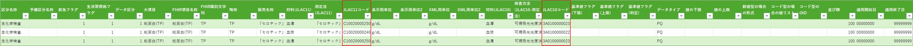

# JLACマスタ月次チェック：手作業編（Excelだけで行うやり方）

> 作成日: 2026-10-16
> 改訂日: 2026-10-16（v2：3章に提出ファイルの画像を追加）
> プロジェクト: 20260831_電カル調査研究_定常業務マニュアル
> 対象: JLACマスタの月次チェックを引き継ぐ担当者。**何をチェックしているのかを理解するため**、および**ツールが使えないときに自分で回すため**の手順
> 位置づけ: **ツール編**（`20261001_JLACマスタチェック手順_vN.md` 8章：HTMLチェックツール、`00_共通/02_output/` の `*_月次実行の使い方_vN.md`：1回実行）と**対**。実務はツールで行い、この手作業編は「ツールが中で何をしているか」の説明を兼ねる
> 出典: 手順書 3章（Step 0〜3）・4章（チェックロジック39件）、および凍結した参照実装 `00_共通/03_scripts/check_jlac_monthly.py` のロジック
> ⚠️ **注意**：この文書のExcel式は、参照実装（Python）のロジックから起こした**例**で、Excelで試験していない。初回は**前月公開版を使って練習**し、結果が既知の内容と合うか確かめる（6章）。**判定の正本は最新版のHTMLチェックツール（`jlac-core`）**で、参照実装は凍結されている。ツールと手作業で結果が違ったら、ツールの判定根拠（ACN確認用の「指摘の根拠」シート）を見て原因を調べる

---

## 1. 何をチェックするのか（全体像）

JLACセンターが毎月1日に提出する、電カル共有向けJLACマスタ（1行＝JLAC11コード1つ、32列）を、厚労省側（ACN）が点検する。

| 目的 | やること | 手順書の章 |
|---|---|---|
| ① 形の誤りを見つける | 空欄・桁数・値の範囲・Excelエラー等（Step 0） | 3章 Step 0・4章 |
| ② コード表との食い違いを見つける | JLAC10／JLAC11のコード表に照らして名称が合うか（Step 0） | 4章 |
| ③ 同じ項目の表記ゆれ・重複を見つける | 大項目・FHIR項目名称・識別文字列・略称の組合せ、コード重複（Step 0） | 4章 |
| ④ 前月から勝手に変わっていないか見る | 前月の公開版と行ごとに突き合わせる（Step 1） | 3章 Step 1 |
| ⑤ 新規行を重点的に見る | 新規行は全指摘を確認する（Step 2） | 3章 Step 2 |
| ⑥ JLACセンターへ疑義を伝える | コメントを書き、本田さんRv後に連携（Step 3） | 3章 Step 3 |

**「既知」の考え方**：前月にも同じ指摘が出ていた行（既存行）は、JLACセンターに何度も言わないよう**コメントしない**（件数だけ控える）。新規行は、全指摘をコメントする。既存行は、前月との差分と、前月は通っていたのに今月落ちたものだけをコメントする。

## 2. 用意するもの

| もの | 中身・入手先 |
|---|---|
| 今月の提出ファイル | JLACセンター提出のxlsx。シートは通常「提出分」＋ABO・Rhのシート。1行目が見出し、2行目以降がデータ |
| 前月の公開版マスタ | 「新のみ」シート（新コードだけの版）を使う。公開用CSVは読めない場合があるので、Excel版を使う |
| JLAC10要素別コード表 | `140jlac10_1.xlsx`（https://www.jslm.org/committees/code/index.html から。毎月最新版） |
| JLAC11要素別コード表 | `jlac11_1_1.0.xlsx`（同上。コードと手順書8-2の表記。実ファイル名は確認する） |
| JLAC11の17桁コードリスト（任意・参考） | `jlac11_3_1.1b.xlsx`（`../20260930_JLACマスター新旧対応表確認/01_input/`）。KA-08の参考確認用 |
| 今月の連絡事項 | JLACセンターのメール（新規行の開始行・再提出の有無・公開日など） |

作業は**コピーを作ってから**行う（提出原本は触らない）。作業用ブックを作り、提出シートの右隣（AG列）に「JLACセンター向けコメント」列を追加する。

## 3. 列の位置（A〜AF の32列）

以降の式はこの列記号で書く。見出し名が違う・列がずれている提出は、まずそれ自体を指摘する（KA-26：33列目以降に値があってはいけない）。

| 列 | 項目 | 列 | 項目 | 列 | 項目 |
|---|---|---|---|---|---|
| A | 区分名称 | L | 測定法（JLAC11） | W | 判定フラグ |
| B | 予備区分名称 | M | **JLAC11コード（17桁）** | X | データタイプ |
| C | 救急フラグ | N | 表示用単位 | Y | 値の下限 |
| D | 生活習慣病フラグ | O | 表示用単位2 | Z | 値の上限 |
| E | データ区分 | P | XML用単位 | AA | 数値書式 |
| F | 大項目 | Q | XML用単位2 | AB | コード型の値リスト |
| G | FHIR項目名称 | R | 材料（JLAC10） | AC | コード型のOID |
| H | FHIR識別文字列 | S | 検査方法（JLAC10-測定法） | AD | 並び順 |
| I | 略称 | T | **JLAC10コード（17桁）** | AE | 適用開始日 |
| J | 販売名称 | U | 基準値フラグ（下限） | AF | 適用終了日 |
| K | 材料（JLAC11） | V | 基準値フラグ（上限） | | |

**コードの桁の区切り（JLAC11／JLAC10とも17桁）**：1〜5桁＝測定物（分析物）、6〜9桁＝識別、10〜12桁＝材料、13〜15桁＝測定法、16〜17桁＝結果単位（JLAC10は結果識別）。式では `MID(M2,10,3)` のように切り出す。

## 4. Step 0：全行にチェックをかける

作業用ブックに「チェック」シートを作り（式は別シートの提出データを `提出!M2` の形で参照する。**チェック列は提出シートの右に置かない**。KA-26のAG列以降の確認に支障が出るため）、提出の行と同じ並びで、チェックごとに1列ずつ式を置く（1行目に見出しとしてチェックIDを書く）。式は2行目に書いて全行にコピーする。結果は「問題あり＝TRUE」とし、フィルターでTRUEの行を絞ってコメントを書く。

### 4-1. 形のチェック（コード表は不要）

| ID | 見ること | 式の例（2行目） |
|---|---|---|
| KA-01 | B・U・V・W列が空欄 | `=COUNTA(B2,U2:W2)>0`（TRUE＝何か入っている） |
| KA-02 | M列が17桁（空欄不可） | `=LEN(TRIM(M2))<>17` |
| KA-03 | C・D列が0か1 | `=OR(AND(C2&""<>"0",C2&""<>"1"),AND(D2&""<>"0",D2&""<>"1"))`（`&""` で文字にして比べる。セルが数値の0/1でも誤判定しない） |
| KA-04 | E列が1か2 | `=AND(E2&""<>"1",E2&""<>"2")` |
| KA-13 | X列がPQかCD | `=AND(X2<>"PQ",X2<>"CD")` |
| KA-14〜16 | X列がCDのとき、Y・Z（下限・上限）／AB（値リスト）／AC（OID）が空欄でない | `=AND(X2="CD",OR(Y2="",Z2=""))`／`=AND(X2="CD",AB2="")`／`=AND(X2="CD",AC2="")` |
| KA-18 | AE列が8桁で「00000000」か実在する日付 | `=AND(AE2&""<>"00000000",OR(LEN(AE2&"")<>8,IFERROR(TEXT(DATE(LEFT(AE2&"",4),MID(AE2&"",5,2),RIGHT(AE2&"",2)),"yyyymmdd")<>AE2&"",TRUE)))`（8桁でない・実在しない日付を拾う。Excelの `DATE` は月13・日32のような値を繰り上げてエラーにしないため、**作り直した日付が元の値と同じか**で実在を判定する。数値の「0」は「00000000に修正」を依頼する） |
| KA-19 | AF列が8桁で「99999999」か実在する日付 | KA-18と同じ形で `AF2` と `"99999999"` に置き換える |
| KA-20 | T列が17桁 | `=LEN(TRIM(T2))<>17` |
| KA-25 | どの列にもExcelエラー値（#NAME?等）が無い | `=SUMPRODUCT(--ISERROR(A2:AF2))>0` |
| KA-26 | 33列目（AG列）以降に値が無い | 作業ブックにコメント列を足す**前に**、元のシートでAG列以降が空か確認する |
| KA-27〜30 | A・F・G・H列が空欄でない | `=OR(A2="",F2="",G2="",H2="")` |
| KA-DUMMY | M列がダミー（仮）コードでない | 式にすると複雑なので、**M列を昇順に並べて目視**＋「仮」「XXX」「ZZZ」「999999」を検索（Ctrl+F）で探す。17桁の英数字大文字（0〜9・A〜Z）以外が混じるものも拾う |
| KA-K | どの列にもケルビン記号（K：U+212A）が無い | `=LEN(TEXTJOIN("",,A2:AF2))<>LEN(SUBSTITUTE(TEXTJOIN("",,A2:AF2),UNICHAR(8490),""))`（半角英字の「K」とは別の文字。見つけたら半角英字「K」に直すよう依頼） |

### 4-2. コード表に照らすチェック

コード表を作業ブックにシートとして取り込む（`コード表_J11結果単位`、`コード表_J11材料`、`コード表_J10分析物`、`コード表_J10材料`、`コード表_J10測定法`）。コードは**文字列**として扱い、先頭の0が落ちている表は3桁（結果単位は表の形）にそろえる。

| ID | 見ること | 取り方 |
|---|---|---|
| KA-06 | N列（表示用単位）が、M列16〜17桁の結果単位コードの単位と一致（**大文字・小文字を区別**） | JLAC11の「結果単位コード」シートで、コード（A列）を探し、名称（B列）または別名（C列。カンマ区切り）と**EXACT**で比べる。例：`=NOT(EXACT(N2,VLOOKUP(RIGHT(M2,2),コード表_J11結果単位!A:B,2,FALSE)))`。TRUEでも、別名（C列）に一致すれば問題なし。コードが表に無ければそれ自体が指摘 |
| KA-07 | K列（材料JLAC11）が、M列10〜12桁の材料コードの名称と一致 | JLAC11「材料コード」シート（コードC列・名称D列）。`=NOT(EXACT(TRIM(K2),VLOOKUP(MID(M2,10,3),コード表_J11材料!C:D,2,FALSE)))`。差が「（）の全角・半角」「空白」だけなら、「他のレコードと合わせて半角に」等、表記の指摘にする |
| KA-21 | T列1〜5桁が、JLAC10の分析物コードに存在する | JLAC10「分析物コード」シート（コードD列、6行目から）。`=ISNA(MATCH(LEFT(T2,5),コード表_J10分析物!D:D,0))` |
| KA-22 | R列（材料JLAC10）が、T列10〜12桁の材料コードの名称と一致 | JLAC10「材料コード」シート（コードG列・名称H列、10行目から）。`=NOT(EXACT(TRIM(R2),VLOOKUP(MID(T2,10,3),コード表_J10材料!G:H,2,FALSE)))` |
| KA-23 | S列（検査方法）が、T列13〜15桁の測定法の名称と一致 | JLAC10「測定法コード」シート（コードD列、名称E列と名称2のF列、6行目から）。S列は「名称1」「名称1＋名称2」「名称1(名称2)」「名称2」のいずれかなら可。**名称1だけで見て違う行**を拾い、F列を足して合うか目で確認する |
| KA-05（参考） | F列（大項目）が、同じ測定物（M列1〜5桁）の既存の大項目と同じ | 前月公開版で同じ5桁の大項目を引き、新規行で違うものを目視 |
| KA-08（参考） | L列（測定法JLAC11）が、17桁コードリストの測定法名称と一致 | 17桁コードリスト（測定物・識別・測定法の組合せ）で引く。測定法が000のコードは対象外 |
| KA-09（参考） | P・Q列（XML用単位）が、UCUMに載っている | 前月に無い単位だけ、UCUM（terminology）のcode/displayで目視（「[]」は無視） |
| KA-24（参考） | N列（表示用単位）が、T列16〜17桁（結果識別）と整合 | 前月に無い「結果識別×表示用単位」の組合せだけ目視 |

### 4-3. 行をまたぐチェック（グループ・重複）

「チェック」シートに、条件付きの集計列を作る。式は `COUNTIFS` またはピボットテーブルで同じことができる。

| ID | 見ること | やり方 |
|---|---|---|
| KA-10 | 同じ**大項目**（F）に、FHIR項目名称（G）／識別文字列（H）／略称（I）の組合せが**1通りだけ** | F・G・H・Iを `&"|"&` でつないだキー列を作り、F列ごとに異なるキーが**2種類以上**あれば指摘。**ピボットテーブルが確実**：「F」を行、「キー」を値（データモデルに追加して「個別カウント」）にし、2以上の行を見る。式で行う場合は、キー列を重複排除した一覧を作り、F列ごとに `COUNTIF` で数える（データ範囲は `$F$2:$F$n` の固定範囲にする。列全体を指定すると空行で `#DIV/0!` になり、1万行超では重い）。空欄のキーは対象外 |
| KA-11 | 同じ**FHIR識別文字列**（H）に、大項目・FHIR項目名称・略称が1通りだけ | 同上（キーを F・G・I にする） |
| KA-12 | 同じ**略称**（I）に、大項目・FHIR項目名称・識別文字列が1通りだけ | 同上（キーを F・G・H にする） |
| KA-17 | 同じ**FHIR項目名称**（G）は、**並び順**（AD）が同じ | G列ごとにADの種類が2以上ないか |
| KA-32 | 同じ**JLAC10コード**（T）に、異なるFHIR識別文字列（H）が無い | T列ごとにHの種類が2以上ないか |
| KA-31 | **JLAC11コード**（M）が重複しない | `=COUNTIF(M:M,M2)>1`（提出が複数シートの場合は全シートを1つにまとめて数える） |
| KA-33 | 『その他の測定法』（M列13〜15桁＝000）の行には、測定法が決まったコードが同時に存在する | M列の13〜15桁を除いたキー（`LEFT(M2,12)&RIGHT(M2,2)`）を作り、000の行について、同じキーで000以外の行が1つ以上あるかを`COUNTIFS`で数える。0なら指摘 |
| KA-34 | 000でない測定法コードの適用終了日が99999999以外（終了した）なら、その000の行の適用終了日は99999999のまま | 同じキーの000以外の行に AF≠99999999 があり、000の行のAF≠99999999なら指摘 |

### 4-4. 結果の見方

TRUEの行をフィルターで集め、**行ごとに、どのチェックに当たったか**を確認する。メッセージの書き方は、過去の確認事項一覧（`00_共通/02_output/20261008_コメント文面の統一案_v1.md`）に合わせる。

## 5. Step 1・2：前月との差分と新規行

「前月」シートに前月公開版（新のみ）のJLAC11コード（M列）を置く。

1. **新規行かどうか**：`=ISNA(MATCH(M2,前月!M:M,0))`（TRUE＝新規）。新規行は基本、提出シートの下部に追加される。**JLACセンターのメールに「○行目以降が新規」とあれば、その行以降は前月に同じコードがあっても新規扱い**（旧コードの再掲載。前月行との比較はしない。ツール編の手順書8-5）
2. **新規行**（Step 2）：
   - Step 0の指摘は**すべて**確認する（無視しない）
   - **KA-M1**：適用開始日（AE）が「00000000」でなく、適用終了日（AF）が「99999999」であること
   - 適用開始日が**今回の公開日**（その月の15日）になっているか（違えば「意図した日付か」を確認）
3. **既存行**（Step 1）：前月の同じコードの行と、32列を1つずつ比べる（`XLOOKUP` で前月の値を引いて、列ごとに `<>` で比べる）
   - **KA-M2**：適用開始日（AE）が前月から変わっていない
   - **KA-M3**：適用終了日（AF）が変わった場合、変更後が99999999でない
   - 適用終了日が99999999→日付に変わった場合は、**今回の切替日（公開日）の前日**が想定。違う日付なら「意図した日付か」を確認。それ以外の日付の再設定（バックデート）は要確認
   - 適用開始日・終了日以外の列の変更：全角・半角など表記だけの変更か、中身の変更かを見分けて確認
   - 判断の一覧は手順書 3章 Step 1 の表に従う
4. **削除された行**：前月にあって今月に無いJLAC11コード（`前月!M列` を今月の中で探して `ISNA`）。削除は想定外なので指摘する。ただし、ABO・Rhのシートへ移っている場合があるので、全シートの中で探す
5. **既知の扱い**：前月の確認事項一覧で、同じ行・同じ指摘がすでに出ていたら「既知」として、コメントを書かない（件数だけ控える）

## 6. 練習のしかた（初回は必ずやる）

1. **前月の提出ファイルと、その前の公開版**で、4・5章を一通りやる
2. 前月の「確認事項一覧（ACN確認用）」（`YYYYMM提出分/02_output/`）の指摘と、自分の結果を比べる
3. 食い違う列があれば、式かコード表の取り込み（桁・先頭の0・全角半角）を直す
4. 合ったら、今月分に進む

## 7. Step 3：コメントを書いて連携する

1. 疑義がある行の AG列（JLACセンター向けコメント）に、指摘を書く（1行に複数なら「・」で並べる）
2. 毎月1日の初回提出分のみ、まとめて**本田さんにRv依頼**する（手順書 3章 Step 3・5章スケジュール）
3. OK後、JLACセンターへ連携する。送付前チェック（コメント・変更履歴の削除）は定常業務マニュアル11章

## 8. ツール（自動化）との対応

| 手作業の工程 | ツール編での対応 |
|---|---|
| 4章 Step 0（39件） | HTMLチェックツール（手順書8章）の判定。同じロジック `jlac-core` |
| 5章 Step 1・2（前月比較・新規行） | ツールが前月公開版と突き合わせて判定 |
| 5章 既知の扱い | ツールの「既知」判定（指摘の文面が前月と同じか） |
| 7章 コメント | ツールが送付用・ACN確認用のExcelにコメントを出力 |
| 全体 | 1回実行（`月次実行.ps1`）：設定→判定→ダブルチェック（Excelでの独立計算）→引継ぎ確認 |

**ダブルチェック**（ツール編）は、この手作業編の考え方（Excel式での独立した検算）をExcel上で自動作成したもの。手作業でやるときは、4章のチェック列そのものが検算になる。

## 9. ⚠️ 未確認・この文書の限界

1. 4・5章のExcel式は、**試験していない**（6章の練習で確かめる）。特に KA-10〜12・KA-33/34 の集計式、KA-DUMMY（目視中心）は、ピボットなど別の手段のほうが速い可能性がある
2. 参照実装は**凍結**（旧ロジック）。現行の判定との差（ツールv21までの改善：重複コードの依頼文、JLACセンターのコメントとの自動照合、その他6〔販売名称の確認〕など）は手順書8-5を見る。手作業編にはまだ反映していない
3. 『その他の測定法』（000）コードの作成、最終化（公開用・取り込み用・新コードのみ）の手作業は、手順書7章・9章を見る。この文書では扱わない
4. 適用終了日のバックデートの詳細な判断基準（手順書で「後日確認」）
5. KA-21は、手順書の定義は「大項目がJLAC10分析物コードと整合」だが、ツール・参照実装は「分析物コードが表に存在するか」だけを見る（名称は未照合）。手作業もそれに合わせた
6. 「既知」の判定：グループチェック（KA-10〜12・17・32）は、前月からある組合せ側は既知、今回新たに生じた組合せ側だけを指摘にする（5章の「同じ行・同じ指摘」は行チェックの説明）

## 10. やったこと・やっていないこと

- やったこと：v2で、3章に提出ファイルの画像（見出しと先頭3行、M列・T列に赤枠）を入れた。v1：手順書 3・4章と、参照実装 `check_jlac_monthly.py` のロジックから、Excelだけで同じチェックをする手順（列の位置・コードの桁・チェックごとの見方と式の例）を書き起こした
- やっていないこと：式のExcelでの試験、前月データでの練習・突き合わせ、現行ツール（`jlac-core`）との照合、ユーザー・本田さんの確認
