# 資料作成パターン集（厚労省・DX機構向け PowerPoint）

- 初版：2026-10-16（厚労省に出した完成形と、ユーザーが「いい感じ」とした自作から抜き出した。評価はユーザーの2026-10-16の発言「表示名の差分に係る資料はいい感じでした」。対象の版は特定されていない）
- 2026-10-16：レビュー担当の点検（原本照合：一致31／食い違い7）を反映
- 使い方：厚労省・機構向けのPPTを作る・直すときに、まず「1. 共通ルール」と「2. 資料の種類」で骨組みを決め、「3. ページの型」から図を選ぶ。文面は「4. 文言」、出す前に「5. チェックリスト」
- 見た目は**厚労省フォーマット**に合わせる。社内スキル `_基盤/_ツール/acnpptx/` はレイアウトに迷ったときの参考だけ（ブランド・紫・角丸禁止などは持ち込まない）。借りているのは語彙（ページの役割・図の型・事実と案を分ける）だけ
- 表記：【実測】＝手本ファイルをpython-pptx・画像で確かめた値／【推測】＝手本からの読み取りで裏取りなし／【未確認】＝手本では確かめられない

## 0. 手本（原本は表のパスのとおり。変更しない）

| # | ファイル（`_agent/` から） | 作り手【推測】 | 種類 | 枚数 | 状態 |
|---|---|---|---|---|---|
| 1 | `06_会議/開発課題検討会/20261013/01_input/開発課題検討会_20261013_厚労省側.pptx` | 厚労省側（ACN作成） | 検討会の厚労省側付議資料 | 9 | FIX |
| 2 | `06_会議/開発課題検討会/20261013/01_input/開発課題検討会_20261013.pptx` | DX機構（説明者欄が機構の担当者） | 検討会の本体資料 | 23 | FIX |
| 3 | `06_会議/開発課題検討会/20261005/01_input/20261005_1330_開発課題検討会_議事要旨_確定版.pptx` | DX機構 | 議事要旨（確定版） | 7 | FIX |
| 4 | `06_会議/開発進捗連絡会議/20261013/01_input/20261013_全国的な運用開始に向けたポータルサイトの蓋開けに係る調整について.pptx` | DX機構（機構ロゴ入り） | 機構→厚労省の調整依頼。**機構フォーマット**（参考扱い） | 12 | FIX（機構） |
| 5 | `02_仕様・技術/20261013_臨床情報詳細画面・PDF差分確認/01_input/20260902_血液型の共有について.pptx` | 本田さん（厚労省フォーマット） | 単発の相談資料 | 4 | FIX【推測：会議で使用】 |
| 6 | `02_仕様・技術/20261013_臨床情報詳細画面・PDF差分確認/04_reference/20261015_名称差の相談スライド_WBS確認会_v8_本田さんRv依頼版.pptx` | ユーザー修正＋具体例（p2・p6・p7）はClaude作（評価「いい感じ」） | 単発の相談資料 | 7（5枚目は非表示） | **Rv前・既知の誤りあり**：案件ID221（正しくは213）、検査の改修予定「画面・PDFともにJLAC11優先」（221はPDF・XMLのみ）、「code.codeing」の誤記、具体例のスライドが3枚重複、コメント2件（プロジェクト状況.md 2026-10-15）。**体裁・書き方の手本として使い、中身は写さない** |
| 参 | 同フォルダ `04_reference/…_v7_ユーザー修正版.pptx` と `02_output/…_v7.pptx`（Claude作） | — | ユーザーが何を直したかの比較用 | 3／2 | 比較用 |

- 2・3・4は機構が作った資料だが、2・3は厚労省と同じテンプレート（タイトル・下線・ページ番号の位置が同じ）。4だけ別テンプレート（機構フォーマット）【実測】
- 議事要旨(案)など未確定の版は手本にしていない

---

## 1. 厚労省フォーマットの共通ルール

### 1-1. スライドの大きさ・余白
- **780×540pt（27.52×19.05cm）**。PowerPointの「A4 用紙」設定。手本6本すべて同じ【実測】
- 左右の余白は約39pt。タイトル・ラベル・本文の左端は x≈38.8〜39.9pt にそろう。本文の幅は約702pt【実測】
- 表は幅が足りないとき左右に広げてよい（台帳の表は x≈12、幅≈756pt。#1 p8 は表・ラベルとも x=0）【実測：#1 p7〜9】
- 下端はページ番号の手前（y≈525pt）まで使っている【実測】

### 1-2. タイトル
- 位置：x=39, y=9, 幅702, 高さ45.6pt。**左揃え、Meiryo UI 太字 18.46pt、色 #17375E**（レイアウトの既定値）【実測：#1・#3・#5・#6】
- 手本の実物には上書きもある：#1 p2〜p4 はプレースホルダーではなくテキストボックス（17pt）、#3 は 18pt・tx2【実測】。**自作ではタイトルのプレースホルダーをそのまま使う**
- タイトルの下に**横線（1pt、色 #008899）**が y=55.3pt に引かれる（マスタ・レイアウト由来。自分で引かない）【実測】
- 書き方：**「番号．件名」＋必要なら「（n/m）」**。件名は「〜について」「〜に係るご依頼」「〜の報告（1005断面）」のような**題目**で、結論は書かない【実測：#1・#2・#6】
  - 例外：#5 p2・p3 は番号も（n/m）も無く同じタイトルが2ページ続く（p4 は「４.」）。#3 は「開発課題検討会の共有／議事要旨(案)(1/6)」【実測】
  - 例：「１．口頭同意に係る体制整備状況に関する医療機関の自己申告について（１/３）」「2. 血液型の共有停止に向けたモデル期間データの論理削除・登録抑止に係るご依頼（1/2）」「3.  案件台帳の更新箇所の報告（1005断面）」
  - 番号は、その会議の付議事項・アジェンダの番号と合わせる。会議に差し込む前で番号が決まらないときは「X.」（#6）
  - 続きのページは（2/3）、補足は「（参考）」「（具体例）」を末尾に付ける【実測：#6】
- 長いタイトルは2行になってもよい（#2 p3「1．マスタスケジュールの確認／① 調達・開発スケジュール」、#3「開発課題検討会の共有／議事要旨(案)(1/6)」）【実測】

### 1-3. メッセージライン（リード文）
- acnpptxのような「タイトル下のメッセージライン」は**厚労省フォーマットには無い**。結論・依頼は本文の「ご相談事項」などのラベルの下に書く【実測】
- ただし、ページの目的を1文で先に言うリードをタイトル直下（y≈56〜60pt、12pt、箇条書き1行）に置くことはある【実測】
  - 例：「・ポータルサイトの開発のフィジビリティについて、ご確認いただきたい。」（#1 p3）／「・10/5時点において、計10件の案件のリリース時期を令和10年度以降開発に更新した。」（#1 p8）

### 1-4. セクションラベル（本文の見出しの帯）
- **角丸四角形、塗り #1F497D（または #002060）、白文字 12pt 太字、中央揃え**。幅130〜175pt・高さ17.5〜19.6pt、左端 x≈38.8【実測：#1・#5・#6】
- 本文はラベルの直下（ラベル下端＋約0〜3pt）から始める【実測】
- 手本で使われたラベルの語：背景／背景・状況／課題／ご依頼事項①・②／ご相談事項／ご確認いただきたい事項／来年度の改修案について／共有パターン／参考／具体例（検査項目の場合）
- ラベルの下の二段目の見出し（表や図の名前）は、別の形にして階層を分ける【実測】
  - 角丸・塗り #1F497D 系・白文字 11pt（台帳表の区分名「案件背景などの更新」「取り下げ」、#1 p7〜9）
  - 四角・薄い緑の塗り・黒枠・10pt 太字（「機構の確認結果（表示に差分が生じる箇所）」#6 p1）
  - 白地に影付きの帯（「マスタによる制御した場合の対応事項とスケジュールイメージ」#1 p6）
- 変化形：**ラベルを枠の上辺に重ねる**（本文を #002060 の細枠で囲み、ラベルを枠の左上に半分重ねる。#1 p2）

### 1-5. 本文・フォント・文字の大きさ
- テーマのフォントは Arial（英数）／Meiryo UI（和文）。テーマの色は Office 2007〜2010 の既定（dk2 #1F497D、accent1 #4F81BD、accent2 #C0504D、accent3 #9BBB59、accent6 #F79646）【実測：#1・#2・#3・#5・#6】
- 文字の大きさの段【実測】

| 用途 | 大きさ | 例 |
|---|---|---|
| タイトル | 18.46pt 太字（#2の一部 15〜18pt） | 全手本 |
| セクションラベル | 12pt 太字・白 | 背景／ご相談事項 |
| 本文 | **12pt**（詰まるページは 11pt） | #1 p5・#6 p3 は 11pt |
| 表 | 9pt（見出しは9pt太字が多いが、#3 の議事要旨は太字でない。アジェンダ表は10.5pt） | 台帳表・差分表 |
| 図の中の文字 | 9〜10.5pt（小さい補足 6〜7pt） | 構成図・具体例の図 |
| 注記（※） | 9pt | 表・図の直下 |
| ページ番号 | 8pt | 右下 |
| 表紙の会議名 | 40pt 太字（サービス名20pt、日時18pt） | #2・#3 p1 |

- 本文は「•」の箇条書き。1項目は2〜3行まで。段落を分けたいときは「①②」や「-」の下位項目【実測】
- **本文の箇条書きの強調は太字**。1文の中の要点（期限・方針・結論）を太字にする【実測】
- **赤は、図・表の中の注目箇所、不可（×）とその理由、表の中の結論語（「生じうる」等）、追記箇所に限る**【実測：#6 p1 の差分表「生じうる」が #C00000 太字、#1 p6「×不可」と理由が赤字、#2 p18「※赤字：前回提示時点からの追記箇所」】。黄色の文字の例もある（#1 p3 のラベル内「（単独の登録画面）」）
  - 例：「確認の結果、…について、**以下表のとおりFHIRパスの差分が生じており、臨床情報詳細画面とPDFの表示にも差分が生じかねない状況である**ことから、…」（#6 p1）

### 1-6. 色の使い方【実測】
- 見出し系の紺：#1F497D／#002060／#17375E（タイトル・ラベル・表の見出し行）
- 表の見出し行：**紺の塗り＋白文字**（台帳・アジェンダ・議事要旨）か、**薄い塗り＋黒文字太字**（ピンク #F2CEEF・薄オレンジ #FBE2D5・薄青。相談資料の表）
- 表の本文セル：白地。格子の罫線（黒・細）
- **赤（#FF0000／#C00000）**：図・画面の中の「ここを見て」の枠、×（不可）、表の中の結論語・追記箇所。本文の箇条書きには使わない
- **黄色 #FFFF00 の塗りタグ**：画面キャプチャの上の札（「記事（開発不要）」「画面（要開発）」）、再掲資料の札（「参考：10/5 開発課題検討会資料(厚労省)」）
- 吹き出し：薄いオレンジ（accent6 系）の塗り【実測：#1 p6・#5 p4】。色の正確な値（明るさの調整）は【未確認】
- 可否のマス：×＝赤字＋薄い赤の塗り、△＝薄い緑の塗り、○＝白地（#1 p6）
- グラフ（棒・円）は手本に無い

### 1-7. ページ番号
- 右下、8pt、マスタの番号（自分で置かない）【実測】。付議事項一覧の1枚目にも番号が出る
- **注意**：#5・#6 は開始番号が 0 に設定されていて、1枚目が「0」と出る【実測】。#5 を土台にして作ると引き継ぐ。会議資料に差し込むと番号は振り直されるため実害は小さいが、単独で出すときは確認する

### 1-8. 出典・注記の書き方【実測】
- 表・図のすぐ下に「※」で始める注記を 9pt で置く
  - 例：「※code.textはFHIRの定義上、必須項目となっている」（#6 p1）／「※患者共有ボタンの押下後に、患者が自身のマイナポータルで閲覧できるようになる」（#5 p3）
- 表のセルの中の語に「※」を付け、表の下で説明する（「「code.text※」より出力」→ 表の下に※の説明）
- 前の会議の資料を再掲するときは、タイトルの右上に黄色の札「参考：10/5 開発課題検討会資料(厚労省)」（#2 p21。p22・p23 の札には「(厚労省)」が無い）
- 根拠の資料名は本文か見出しに書く（「本事象に関係するFHIRパスの定義（JP-CLINS v1.13.0）」#6 p4、「10/5開発課題検討会にて、機構より「…」との回答を受けている」#6 p1）
- 画像の出典は画像の下に小さく【推測：厚労省フォーマットの手本に例が無く、機構フォーマットの #4 p12「（参考：厚生労働省HP「電子処方せん対応の医療機関・薬局についてのお知らせ」）」のみ】
- 凡例・色の意味は、使ったページに書く（「※赤字：前回提示時点からの追記箇所」#2 p18、「※黄色ハイライトは日程調整中」#2 p6、スケジュールの右上に「凡例」の箱 #2 p3）

### 1-9. 「案」「機密」などの表記【実測】
- 議事要旨のタイトルは、**確定版でも「議事要旨(案)(1/6)」のまま**だった（#3）。表紙の右上に「議事要旨」の札（薄オレンジ塗り・黒枠・20pt）
- 本文中の未確定：「（案）」（成果物（案））／「【検討中】」／「※文言は未定」／「(要確認)」／「(仮称)」
- 「機密」「取扱注意」「社外秘」の表記は、厚労省フォーマットの手本には無い【実測】。機構フォーマット（#4）は表紙の右上に重要性分類（「Ⅱ」）を入れる
- 手本の1枚目（#5 の空のスライド）に「Copyright © 2020 Accenture All Rights Reserved.」のフッターが残っている【実測】→ 土台にするときは消す

### 1-10. 資料名（ファイル名）【実測】
- `開発課題検討会_20261013_厚労省側.pptx`（会議名_日付_誰の分）
- `20261005_1330_開発課題検討会_議事要旨_確定版.pptx`（日付_開始時刻_会議名_種類_状態）
- `20261013_全国的な運用開始に向けたポータルサイトの蓋開けに係る調整について.pptx`／`20260902_血液型の共有について.pptx`（日付_件名について）
- 自作の作業中は管理規約の命名（`YYYYMMDD_内容_vN`）。厚労省に出すときのファイル名の決まりは【未確認】（会議資料に差し込むため単独のファイル名は残らないことが多い【推測】）

### 1-11. 表紙
- 会議の本体資料・議事要旨は表紙あり：中央に「電子カルテ情報共有サービス」（20pt）／会議名（40pt 太字）／日時「2026/10/13 13:45～15:15」（18pt）【実測：#2・#3】
- 厚労省側の付議資料は表紙なしで「厚労省側付議事項」（付議事項一覧）から始まる【実測：#1】
- 単発の相談資料は表紙なし（会議資料の1パートとして差し込む前提）【実測：#5・#6】

### 1-12. 厚労省フォーマットと機構フォーマットの違い【実測】

| 項目 | 厚労省フォーマット（#1・#2・#3・#5・#6） | 機構フォーマット（#4） |
|---|---|---|
| タイトル | 左上・紺の太字18.46pt・下に青緑の線 | 青い帯（#00B0F0 系）に白文字の大タイトル＋左に小さな青い角丸の棒を付けた中見出し |
| 本文の字 | 12pt中心 | 14〜18pt中心（字が大きく、画面キャプチャ中心） |
| ロゴ | なし | 右下に機構ロゴ |
| 依頼の示し方 | 「ご相談事項」ラベル＋疑問形 | 見出しの末尾に「→10月末までに確認をお願いします」、目次で★印 |

→ 自分（ACN）が厚労省側として作る資料は厚労省フォーマット。機構フォーマットは真似しない

---

## 2. 資料の種類ごとの構成パターン

acnpptx の語彙で各ページの役割を添える（Evidence＝事実・根拠、Mechanism＝しくみ・具体例、Decision＝判断を求める、Action＝依頼・期限）。厚労省フォーマットには Thesis（結論を言い切るページ）は無く、結論は Decision のページの中で示す【実測からの整理】。

### 2-A. 単発の相談資料（ご相談・論点）— 最もよく作る型
厚労省推奨の構成（2026-10-15 ユーザー経由で受領）＝**背景・状況 → ご相談事項 → 参考**。必要ならセクションを足してよい。

| 順 | ページ | 役割 | 手本 |
|---|---|---|---|
| 1 | 背景・状況（＋確認結果の表） | Evidence | #6 p1、#5 p2 |
| 2 | 具体例（必要なとき） | Mechanism | #6 p7 |
| 3 | ご相談事項（1ページに独立させるか、1の下に置く） | Decision | #6 p3、#5 p4 |
| 4 | （参考）根拠の定義・仕様の抜粋 | Evidence（付録） | #6 p4 |

- 1〜2枚で収まるなら「背景・状況」と「ご相談事項」を同じページに上下で置く（#5 p4、参（ユーザー修正版v7）p1）
- 選択肢を示して判断を仰ぐときは、ご相談事項の下にパターン表（A/B）と構成図（どこで止めるか）を置く（#5 p4）

### 2-B. 会議の厚労省側付議資料（#1）

| 順 | ページ | 役割 |
|---|---|---|
| 1 | 厚労省側付議事項（番号付きの一覧。表紙なし） | 目次 |
| 2〜 | 付議事項ごとに1〜3枚（タイトルに番号と（n/m）） | 各付議事項の中は 2-A と同じ「背景 →（課題）→ ご確認いただきたい事項／ご依頼事項 → 案のイメージ（画面案・スケジュール図）」 |
| 末尾 | 報告事項（台帳の更新箇所の報告など） | Evidence（報告のみ） |

- 付議事項の並びは「判断を求めるもの → 報告だけのもの」の順【実測：#1 の1例（相談2件→報告1件）。一般ルールかは未確認】
- 前回の残りを載せるときは件名の頭に「(20261005 開発課題検討会残アジェンダ)」と付ける【実測】

### 2-C. 選択肢の整理（検討の材料を出す）（#5 p2〜3）

| 順 | ページ | 役割 |
|---|---|---|
| 1 | 背景・状況 → 改修案について（構成図＋「登録時の課題／閲覧時の課題」） | Evidence＋Mechanism |
| 2 | 共有パターン（前提の箇条書き → パターン表A〜D：内容・対象・懸念点） | Decision の材料 |

- 結びは「どの共有パターンとするか整理させていただきたい」（判断は求めるが、案の推しは書かない）

### 2-D. 報告（台帳の更新箇所など）（#1 p7〜9）
- タイトル「3.  案件台帳の更新箇所の報告（1005断面）」→ リード1文（何件を・どう更新したか）→ 区分ラベル → 表。区分ごとに表を分ける（案件背景などの更新／リリース時期の変更／取り下げ）
- 表の列は台帳と同じ（＃／ID／区分／案件種別／案件名称／概要／優先度／備考 or 取り下げ理由）

### 2-E. 議事要旨（#3。作るのは機構、ACNはコメントする側）
- 表紙（右上に「議事要旨」の札）→ 表（No.／アジェンダ／合意形成事項／ToDo）を（n/6）で続ける
- 合意形成事項は「1．案件の新規起票」のような小見出し（太字・下線）＋「✓」＋「•」の箇条書き。ToDo には担当と期限を【厚労省 10/13】の形で書く
- 長いアジェンダは「(続)」で次のページに送る

### 2-F. 会議の本体資料（#2。作るのは機構。参考）
- 表紙 → アジェンダ表（#／アジェンダ／目的〔確認・共有・協議〕／内容／時間／説明者）→ 各議題 → 厚労省アジェンダ → ラップアップ（決定事項・ToDoを明確にする）
- 目的の語は色分け（確認＝緑、共有＝青、協議＝オレンジ）【実測】

### 2-G. 機構→厚労省の調整依頼（#4。機構フォーマット。参考）
- 目次（期限つきで回答がほしい項目に★、下に「10月末までに確定及び回答をいただきたい項目に★を付しています。」）→ 項番ごとのページ。見出しに「→10月末までに確認をお願いします」と期限を入れる
- 厚労省から機構へ依頼を返すときの「期限を見出しに入れる」書き方は参考になる

---

## 3. ページの型カタログ

画像は `資料作成パターン集_図/` に置いた（幅1280px）。

### P-01 付議事項一覧
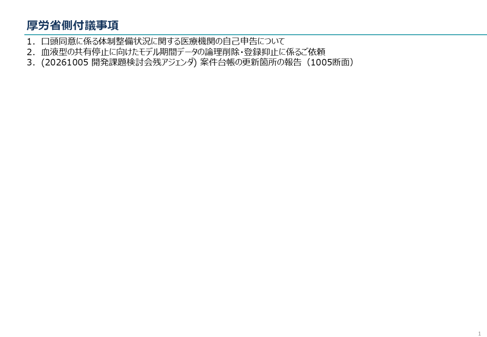
- 使いどころ：厚労省側付議資料の1枚目
- 構成：タイトル「厚労省側付議事項」＋番号付きの件名だけ（「1．」「2．」…、12pt前後）。説明は書かない
- 文言例：「1．口頭同意に係る体制整備状況に関する医療機関の自己申告について」「2．血液型の共有停止に向けたモデル期間データの論理削除・登録抑止に係るご依頼」
- 出典：#1 p1

### P-02 ラベル積み上げ（背景 → 課題 → ご依頼事項）
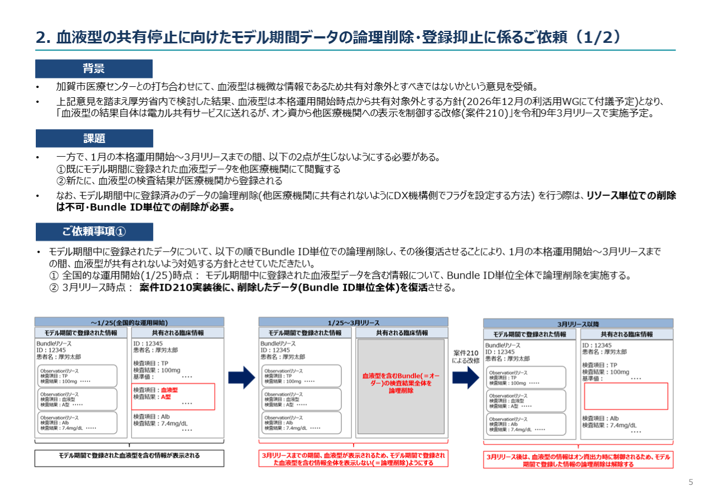
- 使いどころ：相談・依頼の本体ページ。厚労省フォーマットの基本形
- 構成：紺のラベル（12pt白太字）→ 箇条書き（11〜12pt）を縦に2〜3段。下の余白に説明の図（データの流れ・前後比較）
- 文言例：背景「〜という意見を受領。」「〜となり、〜を令和9年3月リリースで実施予定。」／課題「一方で、〜の間、以下の2点が生じないようにする必要がある。」／ご依頼事項「〜する方針とさせていただきたい。①…②…」
- 出典：#1 p5、#5 p2・p4、#6 p1
- 注意：1ページのラベルは3つ程度が目安【推測：手本は2〜3つ】。図は下に置き、矢印で「前 → 後」を示す

### P-03 ラベルを重ねた囲み枠
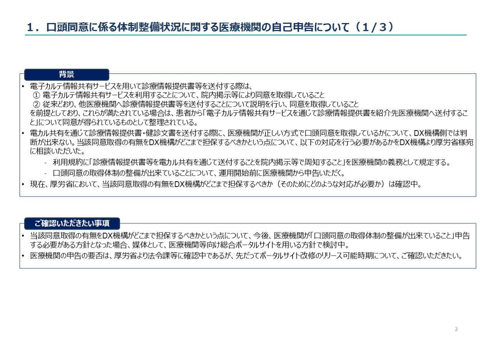
- 使いどころ：文章だけで図が無いページを締まって見せたいとき
- 構成：本文を #002060 の細枠で囲み、ラベル（角丸・紺）を枠の左上に重ねる。「背景」と「ご確認いただきたい事項」の2枠
- 文言例：「現在、厚労省において、〜は確認中。」「医療機関の申告の要否は、厚労省より法令課等に確認中であるが、先だってポータルサイト改修のリリース可能時期について、ご確認いただきたい。」
- 出典：#1 p2

### P-04 2列の比較（暫定対応／恒久対応）＋画面案
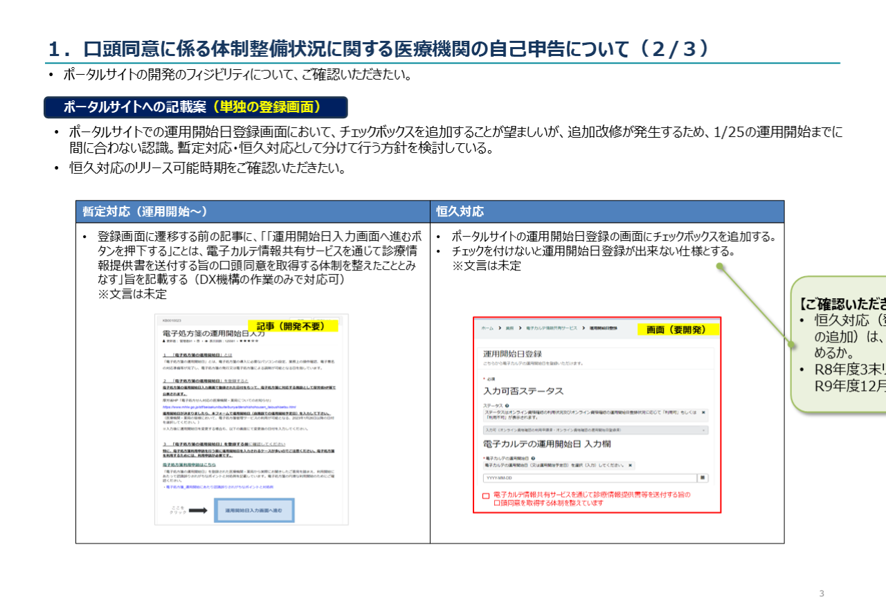
- 使いどころ：対応を段階に分ける案、A案／B案の並列
- 構成：同じ幅の2列（見出し帯＝accent1の青＋太字10.5pt、本文＝白地の枠）。各列に画面キャプチャ、キャプチャの上に黄色の札（「記事（開発不要）」「画面（要開発）」）、変える箇所を赤枠
- 文言例：「暫定対応（運用開始～）」「恒久対応」「※文言は未定」
- 出典：#1 p3〜4
- 注意：#1 p3 は「【ご確認いただきたい事項】」の吹き出しがスライドの右外にはみ出している（FIX版でもそのまま）【実測】。自作でははみ出させない

### P-05 時期×可否のマトリクス（スケジュールイメージ）
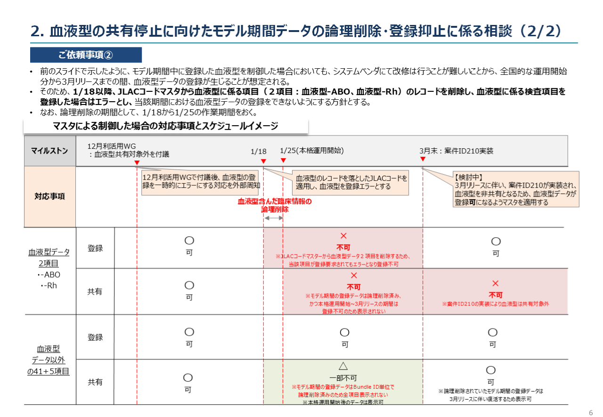
- 使いどころ：期間ごとに「できる／できない」が変わる対応を説明する
- 構成：上段＝マイルストン（▼は赤、日付は黒）、中段＝対応事項（吹き出し）、下段＝行（対象×登録／共有）×列（期間）の表。○可（白）／×不可（赤字＋薄赤）／△一部不可（薄緑）。各マスに「※理由」を7pt
- 文言例：「×　不可　※JLACコードマスターから血液型データ２項目を削除するため、当該項目が登録要求されてもエラーとなり登録不可」
- 出典：#1 p6

### P-06 報告表（台帳の更新）
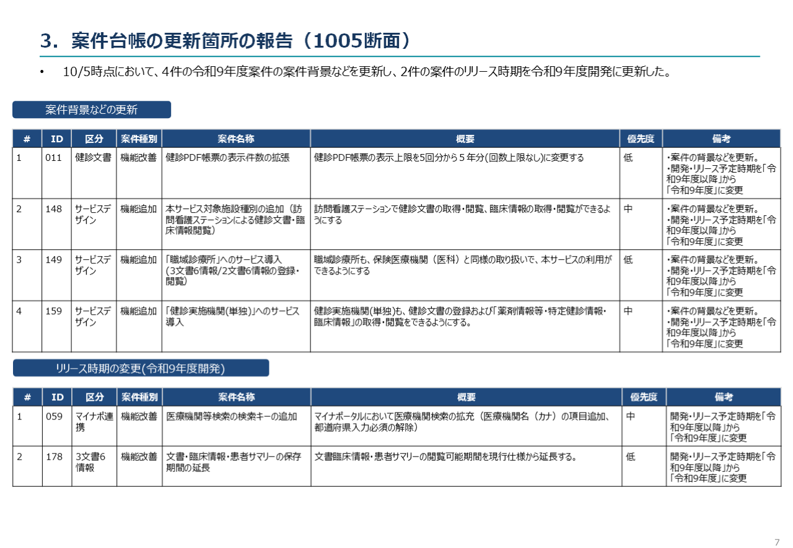
- 使いどころ：件数の多い報告（台帳更新・取り下げ・時期変更）
- 構成：リード1文（何時点で・何件を・どう更新）→ 区分ラベル（角丸・紺・白11pt）→ 表（見出し行＝紺塗り・白9pt太字、本文9pt）
- 文言例：「10/5時点において、4件の令和9年度案件の案件背景などを更新し、2件の案件のリリース時期を令和9年度開発に更新した。」
- 出典：#1 p7〜9、#2 p7

### P-07 アジェンダ表
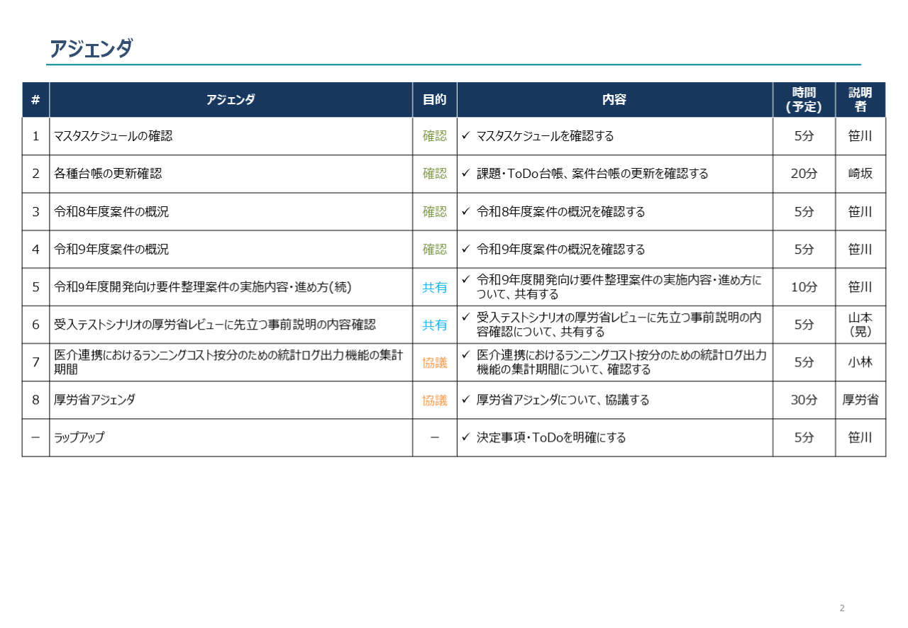
- 使いどころ：会議の本体資料の2枚目（機構が作る。厚労省側で作る会議のときの参考）
- 構成：#／アジェンダ／目的（確認・共有・協議）／内容（✓ 〜する）／時間（予定）／説明者。最後に「ー ラップアップ 決定事項・ToDoを明確にする」
- 出典：#2 p2

### P-08 マスタスケジュール（ガント）
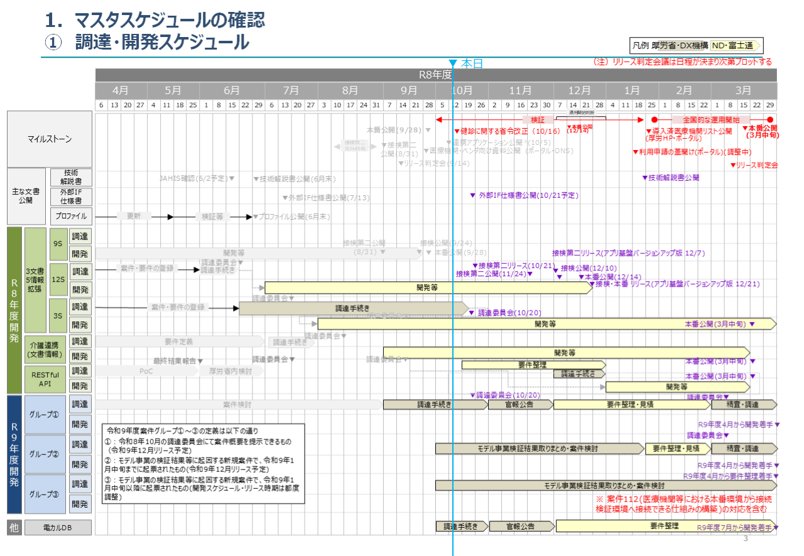
- 使いどころ：調達・開発・公開の全体の時期を見せる（機構が更新。参考）
- 構成：週単位の目盛り、縦の「本日」線、行＝案件群×調達／開発、▼で公開日、右上に凡例、注記（注）
- 出典：#2 p3・p6

### P-09 前提確認・要求を吹き出しで注釈する
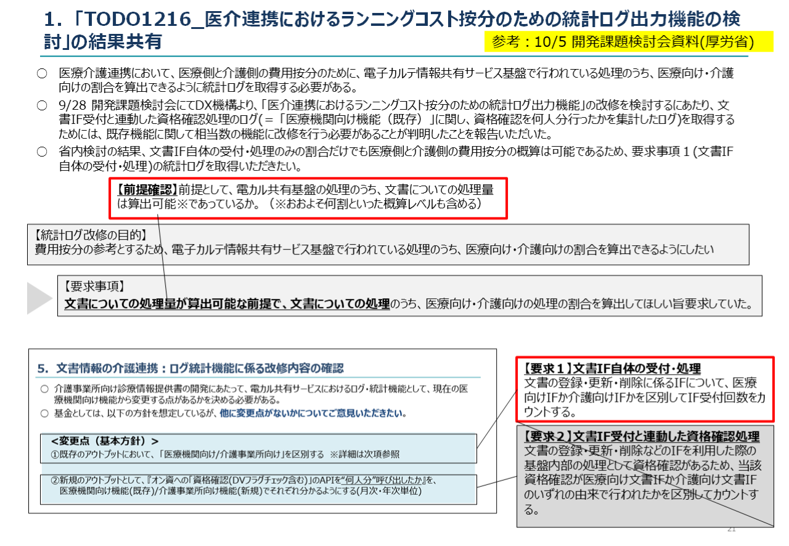
- 使いどころ：前回資料を再掲しながら、こちらの確認事項・要求を書き足す
- 構成：右上に黄色の札「参考：10/5 開発課題検討会資料(厚労省)」、再掲部分（画像）に赤枠の箱と引き出し線で【前提確認】【要求１】【要求２】
- 文言例：「【前提確認】前提として、電カル共有基盤の処理のうち、文書についての処理量は算出可能※であっているか。」
- 出典：#2 p21

### P-10 議事要旨（表紙と表）
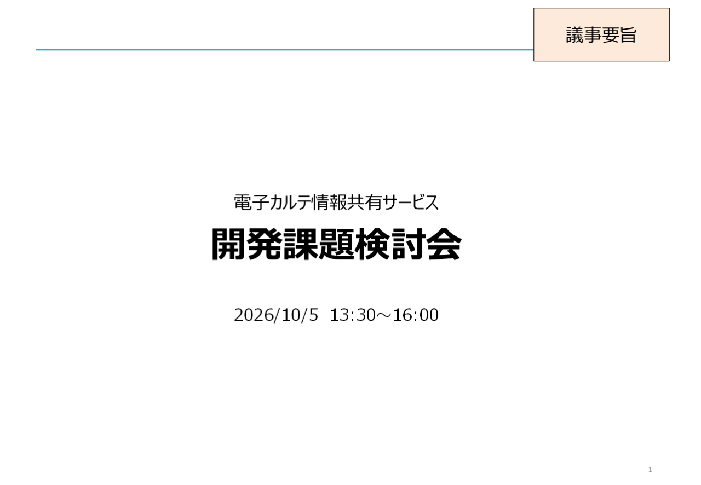
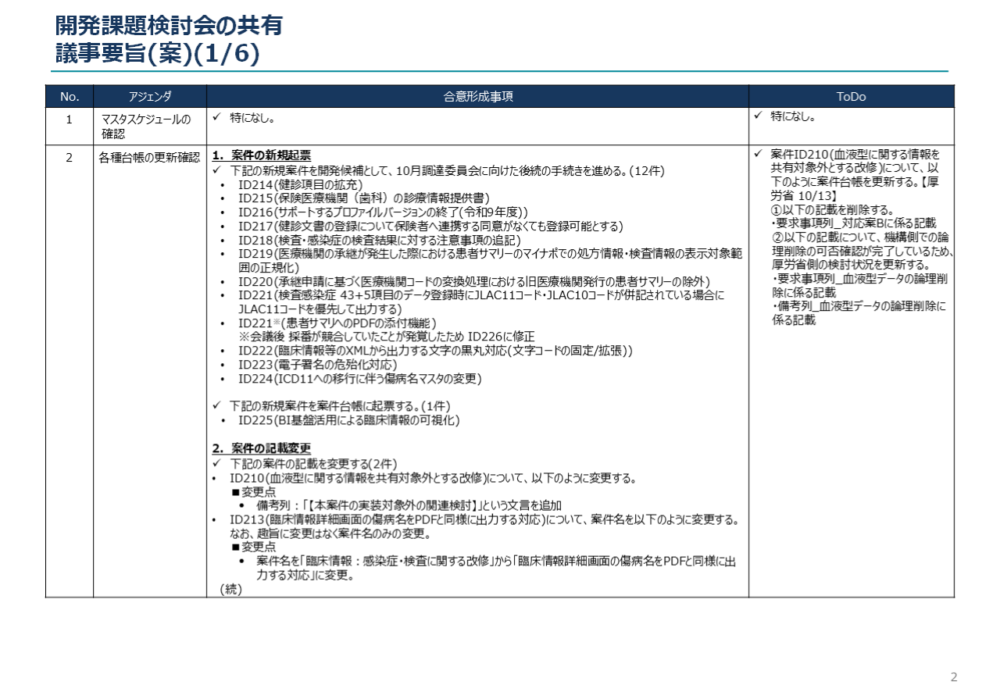
- 構成：2-E のとおり。列幅は No.≈37／アジェンダ≈88／合意形成事項≈423／ToDo≈160pt【実測】
- 出典：#3 p1〜7

### P-11 構成図（登録 → 中央基盤 → 閲覧）＋課題・止める位置
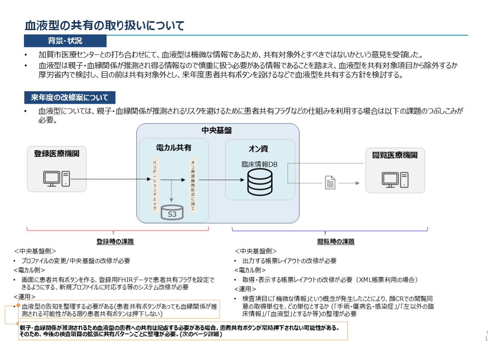
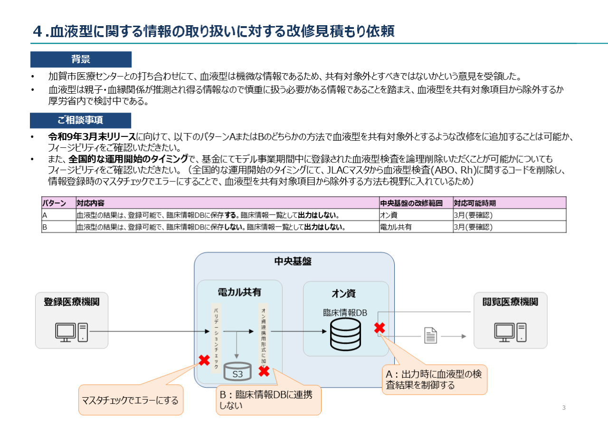
- 使いどころ：どこを改修するか・どこで止めるかを、FHIRを知らない人に見せる
- 構成：左「登録医療機関」（PCのアイコン）→ 中央の大枠「中央基盤」の中に「電カル共有」（バリデーションチェック → オン資連携用形式に加工、S3）と「オン資」（臨床情報DB）→ 右「閲覧医療機関」。止める位置に赤い×、吹き出し（薄オレンジ）で「A：出力時に血液型の検査結果を制御する」。図の下に中かっこ（赤＝登録時、青＝閲覧時）で課題を「＜中央基盤側＞＜電カル側＞＜運用＞」に分けて書く
- 出典：#5 p2・p4（同じ図を使い回している）
- 注意：この図は電カル共有の説明で何度も使える。部品として持ち回る（#5 からコピーする）

### P-12 パターン比較表
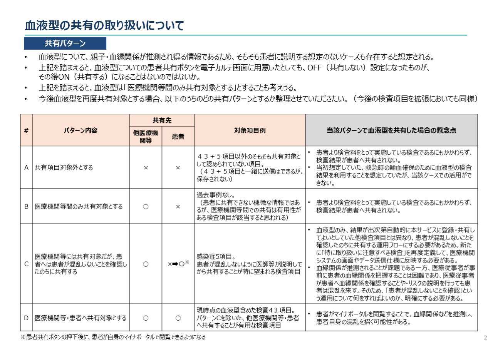
- 使いどころ：取りうる案を並べ、それぞれの懸念を示す
- 構成：前提の箇条書き（「〜と想定される。」「上記を踏まえると、〜ではないか。」）→ 表（＃A〜D／パターン内容／共有先〔他医療機関等・患者〕の○×／対象項目例／懸念点）。見出しは薄オレンジ、懸念点の列だけ灰色
- 文言例：「今後血液型を再度共有対象とする場合、以下のうちのどの共有パターンとするか整理させていただきたい。」
- 出典：#5 p3（小さい版は #5 p4 のA/B表：パターン／対応内容／中央基盤の改修範囲／対応可能時期）

### P-13 差分表（2段の見出し・結合セル・※注記）
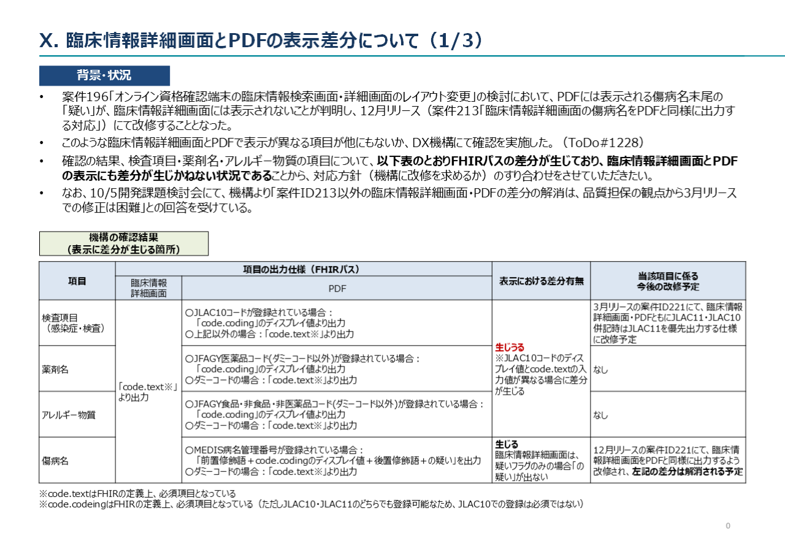
- 使いどころ：画面とPDF、現行と改修後など、同じ項目を2つの出力で比べる
- 構成：見出しを2段（「項目の出力仕様（FHIRパス）」の下に「臨床情報詳細画面」「PDF」）。同じ内容のセルは結合（画面の「「code.text※」より出力」を4行で1つ）。右に「表示における差分有無」（生じうる／生じる＋条件）、「当該項目に係る今後の改修予定」。表の上に二段目の見出し「機構の確認結果（表示に差分が生じる箇所）」、下に※注記
- 文言例：「〇JLAC10コードが登録されている場合：「code.coding」のディスプレイ値より出力／〇上記以外の場合：「code.text※」より出力」
- 出典：#6 p1（ユーザー修正版v7 p1 が元）
- 注意：#6 は Rv前で、この表の中身に既知の誤りがある（傷病名の「案件ID221」は正しくは213、検査の「画面・PDFともにJLAC11優先」は221がPDF・XMLのみ）。**型だけを使い、値は写さない**

### P-14 具体例の図（登録する情報 → 自院の画面／他院のPDF）
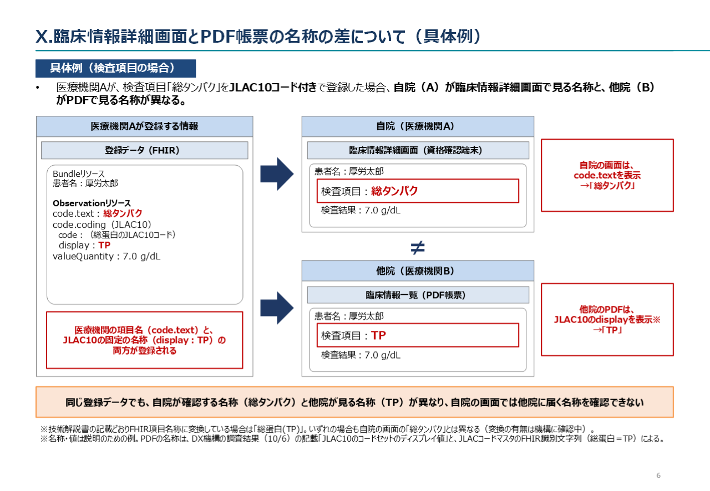
- 使いどころ：差分・不具合を、実際に何が表示されるかで見せる（FHIRを知らない人向け）
- 構成：左に「医療機関Aが登録する情報」（登録データの中身を簡略表示し、効く値を赤字）→ 太い右矢印2本 → 右上「自院（医療機関A）臨床情報詳細画面」、右下「他院（医療機関B）PDF帳票」、間に「≠」。右端に赤枠の短い説明（「自院の画面は、code.textを表示→「総タンパク」」）。下に薄オレンジの帯で結論1文、その下に※注記で例の前提
- 文言例：結論の帯「同じ登録データでも、自院が確認する名称（総タンパク）と他院が見る名称（TP）が異なり、自院の画面では他院に届く名称を確認できない」
- 出典：#6 p7（血液型の資料 #1 p5 の「登録データの中身を箱で見せ、前後を太い矢印でつなぐ」書き方に合わせた。プロジェクト状況.md では本田さんの指示による図とされている）
- 注意：値は実在の仕様値で作り、「※名称・値は説明のための例」と根拠を注記する
- 【未確認】#6 には具体例のスライドが p2・p6・p7 の3枚あり（重複）、p7 を代表にした。本田さんのRvが戻ったら残った版で出典と画像を差し替える

### P-15 参考の定義表
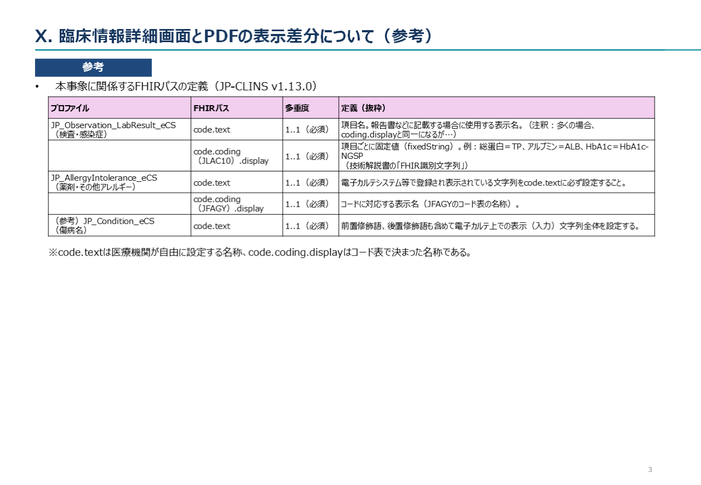
- 使いどころ：判断の根拠になる仕様（プロファイルの定義・技術解説書）を、本文から外して後ろに置く
- 構成：ラベル「参考」→ 1行で何の定義か（「本事象に関係するFHIRパスの定義（JP-CLINS v1.13.0）」）→ 表（プロファイル／FHIRパス／多重度／定義（抜粋））→ 1行の言い換え（「※code.textは医療機関が自由に設定する名称、code.coding.displayはコード表で決まった名称である。」）
- 出典：#6 p4

### P-16 ご相談事項だけのページ
- 使いどころ：背景・具体例が2枚以上になったとき、判断を求める文を1ページに独立させる（会議で画面に映したまま議論できる）
- 構成：ラベル「ご相談事項」＋箇条書き（#6 p3 は2つ【実測：1例】）。要点を太字
- 文言例：「上記のとおり表示に差分が生じうる可能性があるため、改修の可否・時期・費用を機構に照会し、費用対効果を確認した上で、**傷病名(案件213)と同様に、臨床情報詳細画面の名称をPDFに揃える改修を機構に求める方向**でよろしいでしょうか。」「あわせて、改修までの間、差分があることを医療機関に周知するかについてもご意向を伺いたい。」
- 出典：#6 p3（画像なし。下半分が空いても詰めない）

### P-17（参考）機構フォーマットの目次・項番つき画像
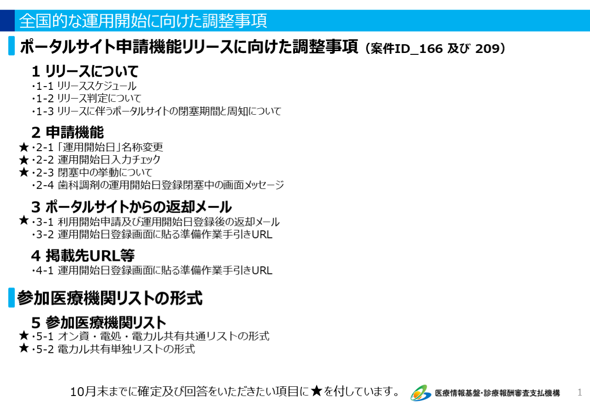
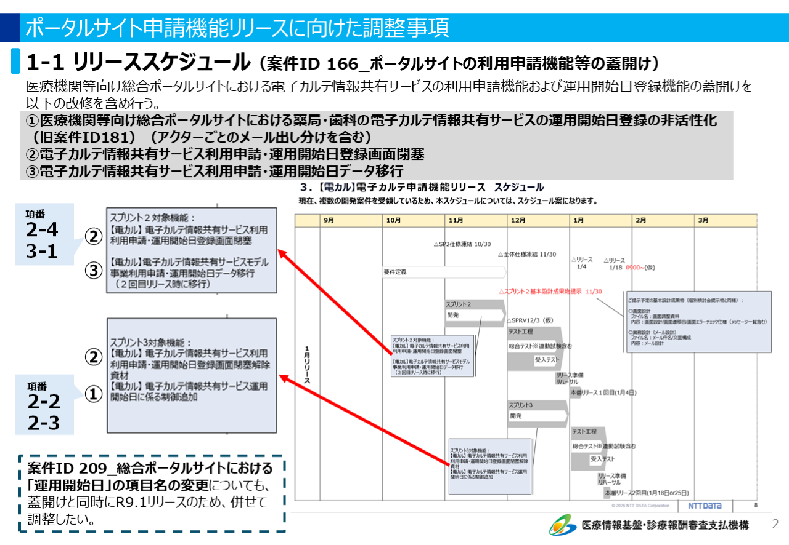
- 機構が作る資料の型。厚労省フォーマットでは使わないが、「回答期限のある項目に★」「画像の要所に①②と項番を付け、赤い矢印で本文と結ぶ」は読み手に親切なので、中身の工夫として借りてよい
- 出典：#4 p2・p3

---

## 4. 文言の書き方

### 4-1. 結論・依頼の示し方
- タイトルは題目（〜について）。結論・依頼は**「ご相談事項」「ご確認いただきたい事項」「ご依頼事項」のラベルの下**に、疑問形・依頼形で書く【実測】
- 1文目で「何を・どの方向で決めたいか」を言い、2文目以降で付帯の確認（周知の要否など）を「あわせて、〜」で足す【実測：#6 p3】
- 選択肢があるときは本文で「パターンAまたはBのどちらかの方法で〜は可能か」と書き、表で中身を示す【実測：#5 p4】

### 4-2. 定型句（手本で使われたもの）

| 場面 | 定型句 | 出典 |
|---|---|---|
| 判断を仰ぐ（方向性） | 〜方向でよろしいでしょうか。 | #6 p3 |
| 意向を聞く | 〜についてもご意向を伺いたい。 | #6 p3 |
| 実現性を聞く（機構へ） | 〜は可能か、フィージビリティをご確認いただきたい。／〜に組み込めるか。 | #5 p4、#1 p3 |
| 確認を求める | 〜について、ご確認いただきたい。 | #1 p2〜4 |
| 方針を示して了承を得る | 〜する方針とさせていただきたい。／〜方針とする。 | #1 p5〜6 |
| 一緒に整理したい | 〜とするか整理させていただきたい。／対応方針（〜か）のすり合わせをさせていただきたい。 | #5 p3、#6 p1 |
| 経緯（受けた） | 〜という意見を受領した。／〜との回答を受けている。／〜旨を報告いただいた。 | #5、#6、#2 p21 |
| 経緯（決まった） | 〜が判明し、〜にて改修することとなった。／〜方針となった。 | #6 p1、#1 p5 |
| 検討中 | 現在、厚労省において、〜は確認中。／〜方針で検討中。／【検討中】 | #1 p2、p6 |
| 未確定 | ※文言は未定／(要確認)／(仮称) | #1 p3、#5 p4、#4（機構） |
| 報告 | 〜時点において、〜件の案件の〜を更新した。 | #1 p7〜9 |

### 4-3. 背景の書き方（4文の型）【実測：#6 p1（元はユーザー修正版v7 p1）の1例】
1. 経緯：「案件196「…」の検討において、〜が判明し、12月リリース（案件213「…」）にて改修することとなった。」
2. したこと：「このような〜が他にもないか、DX機構にて確認を実施した。（ToDo#1228）」
3. 結果と依頼：「確認の結果、〜について、以下表のとおり〜状況であることから、対応方針（〜か）のすり合わせをさせていただきたい。」
4. 制約・前提：「なお、10/5開発課題検討会にて、機構より「〜」との回答を受けている。」

### 4-4. 事実と案を書き分ける
- **事実**は常体の過去形（「〜した」「〜となった」「〜を受領した」）。誰がいつ言ったかを添える（「10/5開発課題検討会にて、機構より」）【実測】
- **案・方針**は「〜方針とさせていただきたい」「（案）」「【検討中】」で、事実と見た目でも分かるようにする【実測】
- **見込み・可能性**は言い切らない：「〜差分が生じかねない状況」「生じうる」＋条件の注記（「※JLAC10コードのディスプレイ値とcode.textの入力値が異なる場合に差分が生じる」）【実測：#6】
- 敬語は依頼・質問の文末だけに使い、背景の文は常体（である調）で短く【実測】

### 4-5. 用語の書き方
- 案件は「案件196「オンライン資格確認端末の臨床情報検索画面・詳細画面のレイアウト変更」」のように**番号＋正式名称を「」で**。2回目からは「案件ID213」だけでよい【実測：#6 の1例】
- 略称：電カル共有／オン資／DX機構（機構）／ToDo#1228。**10/1以降の文面は「機構」**（ユーザー修正版v7 と #6 の非表示スライドに「基金に改修を求めるか」が残っている【実測】→ 直す）
- 日付は「10/5」「1/25」「令和9年3月リリース」「R8年度3末」が混在【実測】。1つの資料の中ではそろえる【推測：好ましい】

### 4-6. 厚労省はFHIRに詳しくない — 噛み砕き方（ユーザー修正から）
ユーザーが Claude 作のv7を直した点【実測：`02_output/…_v7.pptx` と `04_reference/…_v7_ユーザー修正版.pptx` の比較】
- FHIRの完全なパス（`Observation.code.text`）→ **「「code.text※」より出力」**に短くし、表の下の※で「code.textはFHIRの定義上、必須項目」と補う
- 列見出しを2段にし、同じ内容のセルを結合（読む量を減らす）
- 条件分岐は「〇〜が登録されている場合：〜より出力／〇上記以外の場合：〜」の形
- 「差分が生じる」→「生じうる」と言い切りを弱め、条件を注記
- 本文の「機構への確認事項」の節は外した（厚労省に見せる資料に機構への宿題を混ぜない）
- 参考ページの説明は1行に絞った（「code.textは医療機関が自由に設定する名称、code.coding.displayはコード表で決まった名称である。」）

その後、v8 でユーザーの依頼・本田さんの指示により具体例の図（P-14）を足した（「総タンパク」と「TP」。Claude作・Rv前）＝**仕組みではなく、画面に何が出るかで見せる**

---

## 5. 作るときのチェックリスト

1. 土台は厚労省フォーマットのファイル（#5 `20260902_血液型の共有について.pptx` など）を複製して作ったか。スライドの大きさが 780×540pt か
2. タイトルは「番号．件名（n/m）」の題目か。番号は会議の付議事項・アジェンダと合っているか（未定なら「X.」のまま本田さんに確認）
3. 構成は「背景・状況 → ご相談事項 → 参考」になっているか（足したセクションは理由があるか）
4. ご相談事項は疑問形・依頼形で、1文目で何をどの方向で決めたいかが分かるか
5. 事実（過去形・出典つき）と案（方針とさせていただきたい／（案）／【検討中】）と見込み（〜うる）が書き分けられているか
6. FHIRの用語は短くし、※注記・参考ページ・具体例で補ったか（厚労省が1回読んで分かるか）
7. 文字の大きさは段どおりか（本文12／11pt、表9pt、注記9pt）。本文の強調は太字か。赤は図・表の中の注目箇所・不可（×）・表の結論語・追記箇所に限っているか
8. 表・図の下に※注記と根拠（資料名・版・日付）を書いたか。再掲資料には「参考：○/○ ○○資料」の札を付けたか
9. 案件番号・正式名称・日付・「機構」表記は正しいか（案件番号の取り違えに注意：手本 #6 にも「案件ID221」と「213」の取り違えあり【実測】）
10. スライドの外にはみ出した図形・非表示スライド・重複スライド・「XX」などの仮置きが残っていないか
11. ページ番号の開始値（0始まりになっていないか）、テンプレート由来の Accenture のフッター・作成者などのプロパティが残っていないか。使っていないスライドマスタ（#5・#6 には Accenture のマスタが入っている）を削除したか
12. 社外向けは本田さんRvを通したか。出す前に `python _agent/_基盤/_ツール/送付前チェック.py <ファイル>`（コメント・変更履歴・プロパティ）を実行したか

---

## 6. 今後のストックのしかた

FIX版（厚労省に出した完成形）を受け取ったら：
1. 原本はその会議・案件フォルダの `01_input/` に置く（このパターン集のフォルダには置かない）
2. 自作の資料が厚労省に出て直されて戻ってきたら、出した版と戻ってきた版の差を見る（何を直されたか＝厚労省の好み）
3. このファイルに足す
   - 「0. 手本」の表に1行（ファイル・作り手・種類・枚数・**状態（FIX／Rv前／既知の誤り）**）。Rv前の資料は、FIX版が出たら入れ替える
   - 新しい型があれば「3. ページの型」に P-xx を足し、代表スライドの画像を `資料作成パターン集_図/` に置く（幅1280px、番号_型の名前_出典p番号.png。画像は合計20枚程度に保ち、増えたら古い例と入れ替える）
   - 新しい定型句は「4-2」の表に、直された点は「4-6」に、出典つきで
   - 共通ルールと違う実測値（字の大きさ・色・位置）が出たら「1.」を直し、**【実測】には根拠にした手本の番号を必ず書く**。1本だけから言えることは「1例」と書く。機構フォーマット（#4 など）は共通ルールの根拠にしない
4. 推測と未確認は、手本で確かめられたら【実測】に書き換える
5. 画像の作り方：PowerPoint で開いているファイルには触らず、一時フォルダに複製してから PowerPoint COM の `Slide.Export(path, "PNG", 1280, 886)` で書き出す（既に開いているプレゼンテーションは閉じない）

---

## 7. 未確認事項

- 厚労省に出すときのファイル名の決まり（会議資料に差し込むのか、単独で出すのか）
- 「機密」「取扱注意」などの表記が要る資料があるか（手本には無い）
- 議事要旨の確定版でタイトルの「(案)」を残すのが決まりか、たまたまか
- 吹き出し・薄い塗りの正確な色（テーマ色に明るさの調整がかかっていて、値は画像で見た近似）
- ページ番号の色（マスタは tx1 指定だが画像では灰色に見える）
- 厚労省が自分で作る資料（ACN・機構が作っていないもの）の体裁。今回の手本はすべて ACN か機構が作ったもの【推測】
- 「背景・状況 → ご相談事項 → 参考」が厚労省のどの範囲（課・会議）で推奨されているか（2026-10-15 ユーザー経由で受領した情報のみ）
